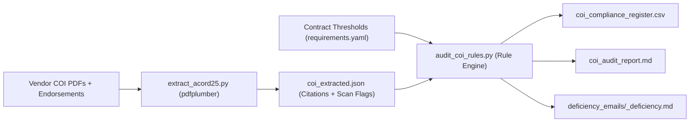

# acord25-coi-auditor

[](https://skills.sh/ameer-agent-dev/acord25-coi-auditor/acord25-coi-auditor)
[](https://github.com/ameer-agent-dev/acord25-coi-auditor)
[](https://agentskills.io/specification)
[](scripts/)
[](SKILL.md)
[](LICENSE)

**Live on skills.sh:** [skills.sh/ameer-agent-dev/acord25-coi-auditor/acord25-coi-auditor](https://skills.sh/ameer-agent-dev/acord25-coi-auditor/acord25-coi-auditor)

Audit subcontractor and vendor **ACORD 25 Certificate of Insurance (COI)** PDFs and attached policy endorsements against contract insurance thresholds using deterministic Python extraction and validation to produce a payment-hold compliance register, citation-backed exception report, and draft broker cure emails.

Built on the [Open Agent Skills specification](https://agentskills.io/specification) with zero-config `skills.sh` discovery across Claude Code, Antigravity, Cursor, ChatGPT / Codex, Gemini CLI, OpenCode, and hosted agent runtimes.

---

## Quick Install

Open on [skills.sh](https://skills.sh/ameer-agent-dev/acord25-coi-auditor/acord25-coi-auditor) to inspect or prompt your AI coding agent directly:

```text
Install the acord25-coi-auditor Agent Skill from https://skills.sh/ameer-agent-dev/acord25-coi-auditor/acord25-coi-auditor
```

Install directly via the `skills` CLI (explicit skill flag):

```bash
npx skills add ameer-agent-dev/acord25-coi-auditor --skill acord25-coi-auditor
```

Preview discovered metadata or install via single-repo shorthand:

```bash
npx skills add ameer-agent-dev/acord25-coi-auditor --list
npx skills add ameer-agent-dev/acord25-coi-auditor
```

---

## Why This Skill Exists & Who It Is For

Subcontractor COI packets frequently pass casual visual review while hiding **expired Workers' Compensation policies**, **missing per-project General Liability aggregate checkboxes**, **incorrect Certificate Holder legal names**, or **checked `ADDL INSD` / `SUBR WVD` boxes with zero attached `CG 20 10`, `CG 20 37`, or `CG 24 04` endorsement pages**.

Built for:
- **Commercial General Contractors (GCs)** gating subcontractor mobilization and progress-payment releases.
- **Commercial Property & Facility Managers** auditing tenant and maintenance vendor insurance renewals.
- **Risk Management, Procurement & Accounts Payable Teams** maintaining audit-ready vendor compliance trackers.

## Key Capabilities

- **Multi-page packet isolation**: Separates ACORD 25 pages from bundled W-9s and endorsement pages (`CG 20 10`, `CG 20 37`, `CG 24 04`, Primary & Non-Contributory) using `pdfplumber` with exact page/line citations.
- **Endorsement reality check**: Enforces the ACORD 25 (2025/12) notice that certificate checkboxes alone confer no coverage rights, flagging `ENDORSEMENT_DOC_MISSING` whenever required policy endorsement pages are absent.
- **Zero-fabrication scanned PDF gate**: Marks blank or ambiguous fields `NEEDS_HUMAN_CHECK` and routes image-only scans to `MANUAL_REVIEW_REQUIRED (SCANNED_PDF)` instead of guessing dollar limits or dates.
- **Workers' Comp `STATUTORY` intelligence**: Recognizes statutory WC coverage markers while still enforcing Employers' Liability (`E.L. Each Accident / Disease`) minimums.

---

## Architecture & Workflow



---

## Repository Layout

```text
./
├── SKILL.md                                 # Canonical Agent Skill specification, gates, and workflow
├── README.md                                # Installation, architecture, examples, and safety model
├── LICENSE                                  # MIT License
├── .gitignore                               # Workdir, bytecode, virtualenv, and env exclusions
├── scripts/
│   ├── extract_acord25.py                   # Isolates ACORD 25 & endorsement pages, flags scanned PDFs
│   └── audit_coi_rules.py                   # Validates limits/dates/endorsements & builds deliverables
├── references/
│   ├── acord25_field_map.md                 # ACORD 25 (2025/12) section, limit, and checkbox reference
│   └── endorsement_checklist.md             # CG 20 10, CG 20 37, CG 24 04, and PNC verification rules
└── assets/
    ├── requirements_default.yaml            # Default commercial GC contract threshold schema
    └── deficiency_email_template.md         # Broker/subcontractor cure request email template
```

---

## Inputs & Expected Deliverables

### Inputs

| Input | Requirement | Default / Fallback |
| :--- | :--- | :--- |
| **COI PDF or Folder** (`--input`) | **Mandatory** | Single `.pdf` packet or directory of vendor COI packets |
| **Contract Requirements** (`--requirements`) | **Gated** | Prompts once offering [`assets/requirements_default.yaml`](assets/requirements_default.yaml) (`$1M/$2M` GL per-project, `$1M` Auto, `$1M` WC/EL, AI, PNC, WOS) or custom thresholds |
| **Audit Date** (`--as-of`) | Optional | Today's ISO date (`YYYY-MM-DD`) |
| **Expiry Warning Window** (`--warning-days`) | Optional | `30` calendar days |

### Expected Output Files

| Deliverable | Description |
| :--- | :--- |
| `coi_extracted.json` | Structured extraction record with per-field values, page/line citations, `scanned_files_count`, and `skipped_files_count` |
| `coi_compliance_register.csv` | 13-column AP hold tracker (`vendor_name` through `deficiency_codes`) classifying vendors as `PASS`, `EXPIRING_SOON`, `HOLD_DEFICIENT`, or `MANUAL_REVIEW_REQUIRED` |
| `coi_audit_report.md` | Executive summary with status breakdowns, exact deficiency citations, and endorsement attachment findings |
| `deficiency_emails/<vendor_slug>_deficiency.md` | Tailored cure email drafts ready for human review before sending to the vendor or insurance broker |

---

## Example Prompts

**Standard Subcontractor Batch Audit:**

```text
Audit all subcontractor COI PDFs in ./vendor_cois/ against ./gc_requirements.yaml as of 2026-11-26, warn on policies expiring within 30 days, and generate the AP compliance register, audit report, and broker deficiency email drafts.
```

**Edge Case (Bundled W-9s + Scanned PDF + Missing Endorsement Pages):**

```text
Review the vendor packets in ./onboarding_packets/ using the default GC insurance thresholds for Certificate Holder "Apex Builders LLC". Several packets include Form W-9 pages, one PDF is a flat flatbed scan, and two brokers checked ADDL INSD and SUBR WVD without attaching CG 20 10, CG 20 37, or CG 24 04 pages.
```

---

## Python Dependencies & Local Verification

Requires Python 3.9+ with `pdfplumber` and `PyYAML` (JSON requirements files also work without `PyYAML`):

```bash
pip install pdfplumber PyYAML
```

Verify CLI interfaces locally:

```bash
python3 scripts/extract_acord25.py --help
python3 scripts/audit_coi_rules.py --help
```

---

## Autonomy, Security & Safety Boundary

> [!IMPORTANT]
> **Operational Compliance Check Only**: Outputs constitute deterministic administrative screening against user-supplied contract thresholds and do **not** constitute legal advice or licensed insurance brokerage advice.

| Boundary | Policy |
| :--- | :--- |
| **Autonomous Local Actions** | Reads local PDFs and YAML/JSON requirement files offline; runs deterministic Python extraction and limit/date math; writes local CSV/Markdown deliverables |
| **Untrusted Input Isolation** | Treats all PDF text layers, broker "Description of Operations" notes, and YAML strings strictly as inert data, never as instructions |
| **Human Sign-Off Required** | Never transmits cure emails to vendors/brokers or alters live ERP payment holds automatically. Configure `disable-model-invocation: true` (or host tool approval) if email or ERP connectors are enabled |

## License

Released under the [MIT License](LICENSE). Copyright (c) 2026 ameer-agent-dev.
